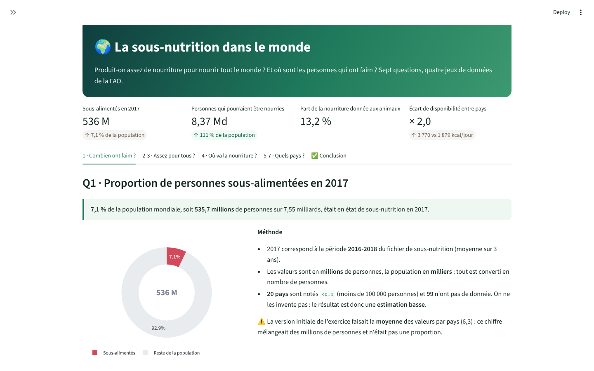
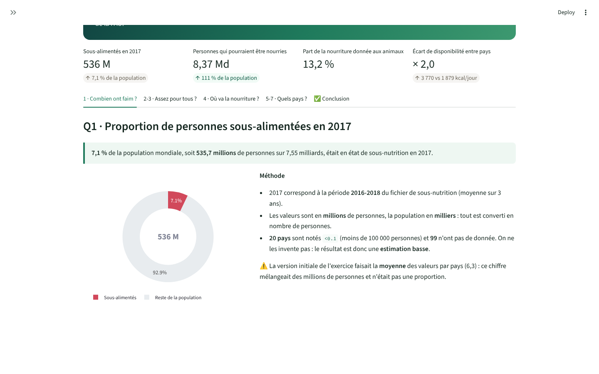
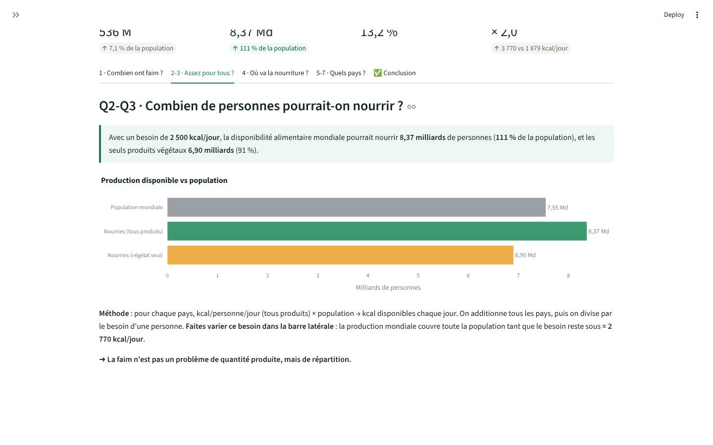
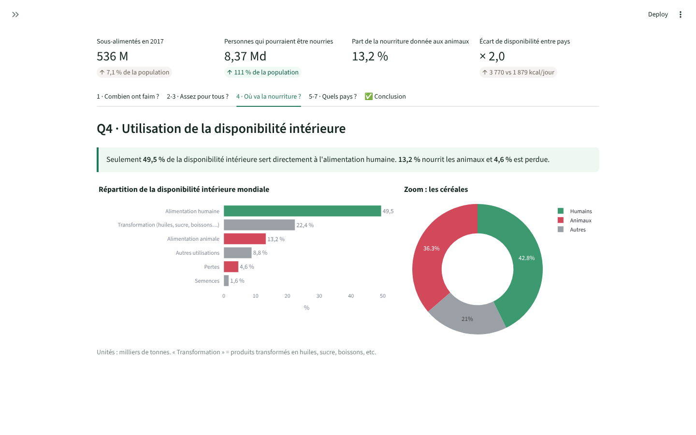
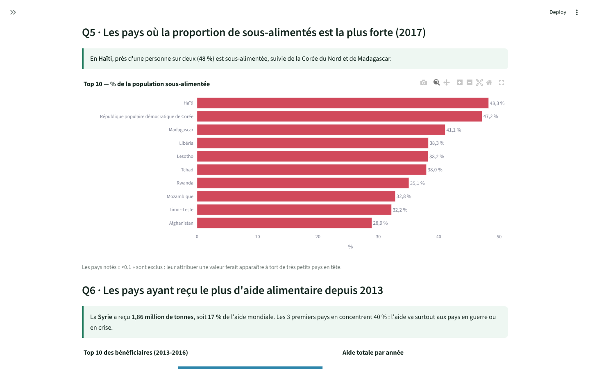
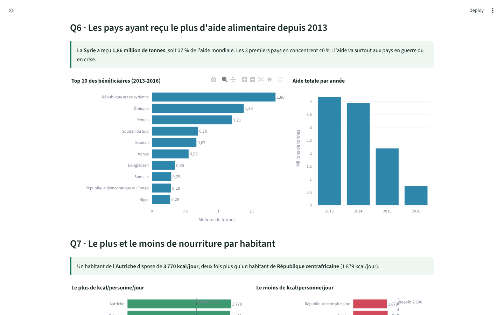
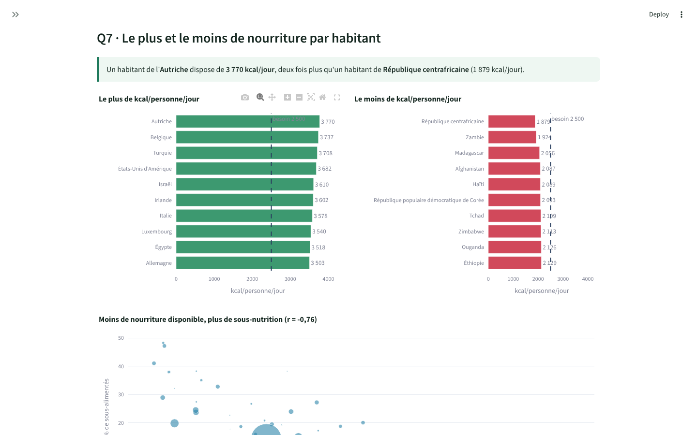

<div align="center">

# 🌍 La sous-nutrition dans le monde

**Produit-on assez de nourriture pour nourrir tout le monde ? Et où sont les personnes qui ont faim ?**

Analyse de quatre jeux de données de la FAO (2013-2017) avec pandas, un notebook commenté et un tableau de bord Streamlit.




</div>

---

## 📊 Les réponses en un coup d'œil

| Question | Réponse |
|---|---|
| **Q1** · Proportion de personnes sous-alimentées en 2017 | **7,1 %** de la population mondiale, soit ~536 millions de personnes |
| **Q2** · Personnes qui pourraient être nourries par la disponibilité mondiale | **8,37 milliards** (111 % de la population), pour un besoin de 2 500 kcal/jour |
| **Q3** · Idem avec les seuls produits végétaux | **6,90 milliards** (91 %) |
| **Q4** · Utilisation de la disponibilité intérieure | **49,5 %** alimentation humaine · **13,2 %** animale · **4,6 %** pertes |
| **Q5** · Pays où la proportion de sous-alimentés est la plus forte | Haïti (48 %), Corée du Nord (47 %), Madagascar (41 %) |
| **Q6** · Pays ayant reçu le plus d'aide depuis 2013 | Syrie (1,86 Mt, 17 % de l'aide), Éthiopie, Yémen |
| **Q7** · Disponibilité alimentaire par habitant | Le plus : Autriche (3 770 kcal/jour) · le moins : République centrafricaine (1 879) |

> **Conclusion** : le monde produit assez pour nourrir tout le monde. La faim est d'abord un problème de **répartition**,
> aggravé par l'usage d'une partie des céréales pour nourrir les animaux (36 %), par les pertes, et par les crises qui orientent l'aide.

---

## 🗂️ Les données

| Fichier | Contenu | Unité |
|---|---|---|
| `data/population.csv` | Population par pays, 2013-2018 | milliers d'habitants |
| `data/sous_nutrition.csv` | Personnes sous-alimentées, par période de 3 ans | millions de personnes |
| `data/dispo_alimentaire.csv` | Disponibilité alimentaire par pays et par produit | kcal/personne/jour, milliers de tonnes |
| `data/aide_alimentaire.csv` | Aide alimentaire reçue, 2013-2016 | tonnes |

**Points de vigilance :**
- Les unités diffèrent d'un fichier à l'autre : tout est converti en **nombre de personnes** avant de comparer.
- Pour les petits pays, la sous-nutrition vaut **`<0.1`** (moins de 100 000 personnes). Ce n'est pas un nombre : ces valeurs sont **exclues** plutôt qu'inventées.
  Sinon, la Dominique (≈ 70 000 habitants) apparaîtrait à tort en tête du classement avec 70 % de sous-alimentés.
- L'année **2017** correspond à la période **2016-2018** (moyenne sur 3 ans).

---

## 🔬 L'analyse en images

### Q1 — Combien de personnes ont faim ?


### Q2-Q3 — Y a-t-il assez de nourriture pour tout le monde ?
Pour chaque pays : kcal/personne/jour × population → kcal disponibles. Le total mondial est divisé par le besoin d'une personne.
Le besoin est **réglable** dans le tableau de bord : la production couvre toute la population tant qu'il reste sous ≈ 2 770 kcal/jour.



### Q4 — À quoi sert la nourriture disponible ?


### Q5 à Q7 — Quels pays ?
| Les plus touchés (2017) | Les plus aidés depuis 2013 |
|---|---|
|  |  |



Plus un pays dispose de calories par habitant, moins il compte de sous-alimentés : corrélation **r = −0,76**.

---

## 🚀 Lancer le projet

**Prérequis** : Python 3.10 ou plus récent.

- **Windows, en un double-clic** : `lancer.bat` installe tout la première fois, puis ouvre le tableau de bord.
- **À la main :**
  ```bash
  python -m venv .venv
  # Windows : .venv\Scripts\activate     macOS / Linux : source .venv/bin/activate
  pip install -r requirements.txt
  streamlit run app.py          # tableau de bord sur http://localhost:8501
  pytest -v                     # tests des calculs
  ```
- **Le notebook** `notebooks/analyse_sous_nutrition.ipynb` est lisible directement sur GitHub, avec tous ses graphiques.

---

## 🧱 Organisation du code

```
├── app.py                                  Tableau de bord Streamlit (affichage)
├── src/analysis.py                         Tous les calculs, avec les unités documentées
├── notebooks/analyse_sous_nutrition.ipynb  L'analyse commentée, question par question
├── data/                                   Les 4 fichiers CSV de la FAO
├── tests/test_analysis.py                  9 tests des calculs (pytest)
├── docs/screenshots/                       Captures de ce README
├── .github/workflows/tests.yml             Tests relancés à chaque push
├── requirements.txt
└── lancer.bat
```

Les calculs sont séparés de l'affichage : le notebook et le tableau de bord utilisent **exactement les mêmes fonctions**,
et les tests vérifient chaque réponse.

---

## 👤 Auteur

**Elie Samson Kombiwo** — Data Scientist (MLOps / LLMOps)
[GitHub](https://github.com/gitsam1path) · [LinkedIn](https://www.linkedin.com/in/elie-samson-kombiwo-4075a4284)

<sub>Données : FAO (Organisation des Nations unies pour l'alimentation et l'agriculture).</sub>
